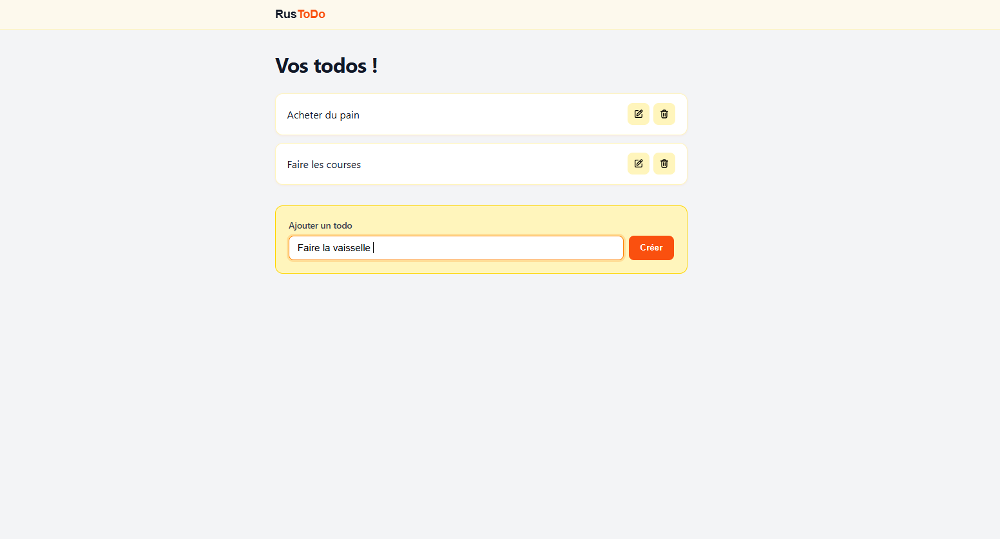
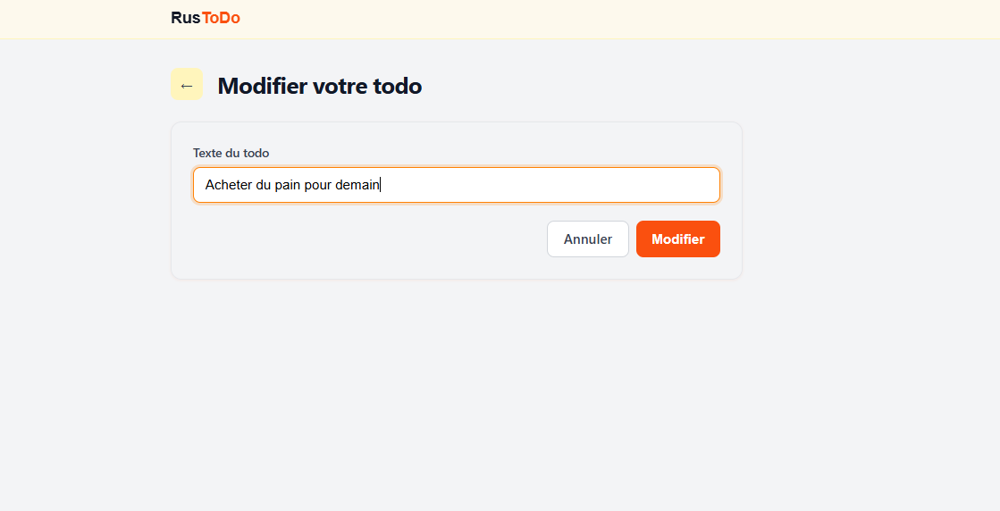

# DemoMot-RusToDo


## Lancement du projet

Premièrement clonez le projet :

```bash
git clone https://github.com/Gillian-LHorset/DemoMot-RusToDo
```

Rendez vous dans `/DemoMot-RusToDo/Docker`.  
Puis lancez le docker compose avec la commande :

```bash
docker-compose up -d
```

Remmontez dans l'archtecture et entrez dans le dossier `/DemoMot-RusToDo/Backend` puis suivez les indication du fichier `README.md`.

Une fois le Backend en route rendez vous dans `/DemoMot-RusToDo/Frontend` et suivez les indications du README.

## Documentation

La majorité du projet à été créer avec le guide suivant :  
https://www.rustfinity.com/blog/create-high-performance-rest-api-with-rust#add-the-.env-file-to-.gitignore

## Galerie



